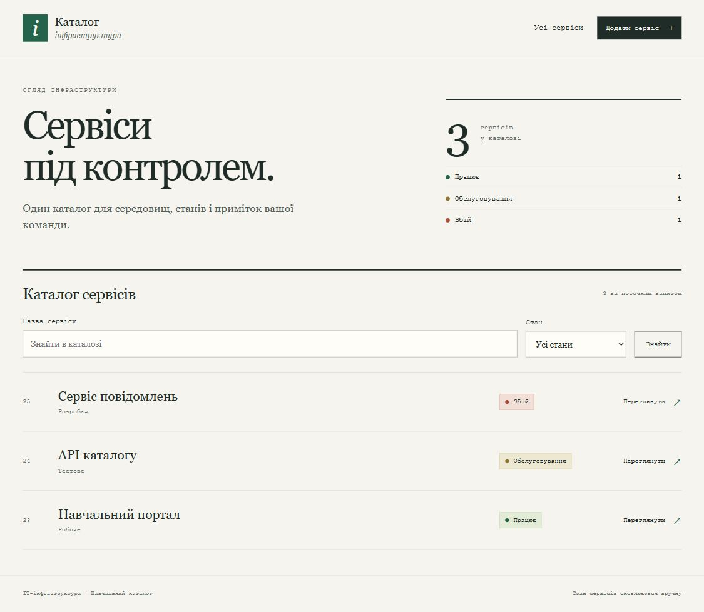

# Laravel CRUD · MySQL · EC2 · RDS Proxy

Застосунок веде каталог сервісів. Доступні додавання, перегляд, редагування,
видалення, пошук за назвою та фільтр стану. Інтерфейс українською.
Після створення, оновлення та видалення запису зміни зберігаються в MySQL.

На EC2 використовується маршрут EC2 → RDS Proxy → RDS MySQL на порту 3306.
AWS SDK читає пароль із Secrets Manager за допомогою instance profile EC2
через IMDSv2. Статичні AWS keys не потрібні. Клієнт перевіряє CA сертифіката.
Секрет запитується при створенні DB-з'єднання, залишається в пам'яті PHP-процесу
й не записується до Laravel config cache, env-файла або HTTP-відповіді.

## Міграції при старті

start.sh виконує infra:prepare-database, а потім php artisan migrate --force --no-interaction.
Лише після успішної міграції запускається локальний вебсервер.
На EC2 міграцію запускає ec2-laravel-migrate.service перед PHP-FPM і Nginx.
Служби вебсервера залежать від успішного завершення міграції.
На кожному завантаженні EC2 цей крок виконується знову.

Laravel створює таблиці migrations і services. Повторний запуск застосовує
лише нові міграції. migrate:fresh і db:seed автоматично не виконуються;
наявні записи не очищуються. Для нового релізу на EC2 bootstrap повторно
запускає migration service перед вебсервером.
Цей стенд розраховано на один EC2.

DB_CREATE_IF_MISSING=true вмикає створення відсутньої SQL-бази перед міграціями.
Потрібне право CREATE DATABASE для заданої назви. За замовчуванням цей крок
вимкнено, і база має бути створена через setup.sql.
Повторний крок використовує CREATE DATABASE IF NOT EXISTS та не очищує дані.
Назва БД може містити дефіс; у SQL вона береться в зворотні лапки.
[Ідентифікатори MySQL](https://dev.mysql.com/doc/refman/8.4/en/identifiers.html).

DB_DATABASE є назвою SQL-бази всередині MySQL. Ім'я інстанса RDS
не створює автоматично SQL-базу з такою самою назвою.
Повний ARN секрету може містити !, зокрема в керованих RDS секретах rds!db.
Вони зазвичай містять master credentials; для окремого користувача
з обмеженими правами використати його власний секрет.
[Керовані RDS credentials](https://docs.aws.amazon.com/AmazonRDS/latest/UserGuide/rds-secrets-manager.html).

## Локальний запуск із MySQL

Потрібні PHP 8.3 або новіший, Composer і MySQL 8.4. Для PHP потрібні pdo_mysql,
mbstring, xml, curl та стандартні розширення Laravel. Версії бібліотек
зафіксовані у composer.lock; збірка Node не потрібна.

~~~bash
composer install
cp .env.example .env
php artisan key:generate
~~~

У локальній MySQL створити базу infrastructure та окремого користувача
з правами на її таблиці й міграції. У .env заповнити DB_HOST, DB_PORT,
DB_DATABASE, DB_USERNAME і DB_PASSWORD. Залишити APP_ENV=local та
DB_AUTH_MODE=local. Локальна конфігурація не потрапляє до Git.
Якщо MySQL вимагає TLS, установити DB_TLS_REQUIRED=true і DB_SSL_CA
на CA локального сервера.

~~~bash
bash start.sh
~~~

Відкрити http://localhost:8767. Скрипт застосує міграції сам.
Для трьох навчальних записів можна окремо виконати seeder.

~~~bash
php artisan db:seed
~~~

## 1. RDS MySQL і користувач

Підготувати приватну RDS MySQL 8.4 у VPC EC2. Перевірити підтримку версії
й регіону у документації RDS Proxy. Використати окремий навчальний EC2
з Ubuntu 24.04 LTS; порт 80 має бути вільним.

З адміністративного вузла з дозволеним доступом до RDS виконати setup.sql.
Пароль адміністратора вводиться на запит клієнта. Файл CA для прямого
підключення до RDS завантажується з офіційного trust store.

~~~bash
curl --fail --show-error https://truststore.pki.rds.amazonaws.com/global/global-bundle.pem -o rds-ca.pem
mysql --host=REPLACE_WITH_RDS_ENDPOINT --port=3306 --user=REPLACE_WITH_ADMIN_USER --password --ssl-mode=VERIFY_IDENTITY --ssl-ca=rds-ca.pem < setup.sql
~~~

setup.sql створює базу infrastructure та ec2_laravel_app з вимогою TLS.
CREATE USER повертає випадково згенерований пароль. Перенести його в Secrets
Manager; вивід цієї команди не включати до Git або навчальних знімків.
Сценарій виконують один раз для нового користувача.
[Створення користувача MySQL](https://dev.mysql.com/doc/refman/8.4/en/create-user.html).

Користувач має SELECT, INSERT, UPDATE, DELETE і права CREATE, ALTER, DROP,
INDEX, REFERENCES у межах infrastructure. Права зміни схеми потрібні,
бо міграції виконуються при старті з цим користувачем.
Адміністративний користувач RDS не використовується вебзастосунком.
Для стенда з окремим migration user потрібне інше розділення credentials;
цей приклад використовує одного користувача для міграцій і CRUD.

## 2. Secrets Manager та ролі

Створити секрет у регіоні RDS з двома рядковими полями.

| Поле | Значення |
|---|---|
| username | ec2_laravel_app |
| password | Пароль, повернений CREATE USER |

Скопіювати повний ARN. Прикріпити до EC2 instance profile з дозволом
secretsmanager:GetSecretValue для цього секрету. iam-policy.json та
iam-trust-policy.json містять шаблони. Для власного KMS-ключа додатково
налаштувати kms:Decrypt і key policy.

Проксі використовує окрему роль з principal rds.amazonaws.com і доступом
до того самого секрета. Її шаблони містяться у proxy-iam-policy.json та
proxy-iam-trust-policy.json. ARN секрета, KMS-ключа та регіон замінити
власними значеннями. У навчальному акаунті з забороною CreateRole потрібна
вже підготовлена роль і дозвіл iam:PassRole. Назва LabRole сама по собі
не підтверджує придатність ролі.
[Роль проксі](https://docs.aws.amazon.com/AmazonRDS/latest/UserGuide/rds-proxy-iam-setup.html).

IMDSv2 на EC2 установити Required. Застосунок явно використовує
InstanceProfileProvider, тому env-ключі та shared AWS profile не підміняють роль.
[InstanceProfileProvider](https://docs.aws.amazon.com/aws-sdk-php/v3/api/class-Aws.Credentials.InstanceProfileProvider.html).

## 3. RDS Proxy для MySQL

Проксі має використовувати engine family MYSQL. Endpoint проксі PostgreSQL
для цього застосунку не підходить. У консолі вибрати секрет ec2_laravel_app,
парольний режим, IAM authentication Not allowed та Require TLS.
Для MySQL 8.4 зі стандартним caching_sha2_password використовувати
MYSQL_CACHING_SHA2_PASSWORD. Тип має відповідати фактичному користувачу БД.
[Параметри проксі](https://docs.aws.amazon.com/cli/latest/reference/rds/create-db-proxy.html).

Перевірити engine family і прив'язану БД у своєму регіоні.

~~~bash
aws rds describe-db-proxies --db-proxy-name DemoDBProxy --region us-east-1 --query 'DBProxies[].{Engine:EngineFamily,Status:Status}' --output json --no-cli-pager
aws rds describe-db-proxy-targets --db-proxy-name DemoDBProxy --region us-east-1 --query 'Targets[].TargetHealth' --output json --no-cli-pager
~~~

Ім'я проксі та регіон замінити, якщо вони відрізняються.
Якщо target ще не зареєстровано, додати підготовлений RDS MySQL.

~~~bash
aws rds register-db-proxy-targets --db-proxy-name DemoDBProxy --db-instance-identifiers REPLACE_WITH_RDS_INSTANCE_ID --region us-east-1 --no-cli-pager
~~~

Тут потрібен identifier інстанса RDS, а не endpoint.
Дочекатися Available у проксі та AVAILABLE у TargetHealth.
Сам Available у endpoint не підтверджує готовність БД.
[Перевірка target](https://docs.aws.amazon.com/AmazonRDS/latest/UserGuide/rds-proxy.troubleshooting.html).

## 4. Мережа

| Група | Вхідне правило |
|---|---|
| sg-ec2 | HTTP 80 із IP викладача або навчальної мережі |
| sg-proxy | TCP 3306 від sg-ec2 |
| sg-rds | TCP 3306 від sg-proxy |
| Адміністративний доступ | Окреме тимчасове правило до RDS для setup.sql |

Вихідний доступ має дозволяти ці з'єднання, DNS і HTTPS до Secrets Manager.
Для bootstrap потрібні GitHub, Ubuntu, Composer і Packagist.
RDS та проксі залишаються приватними; проксі розміщується у VPC бази
щонайменше у двох дозволених підмережах.

У цьому навчальному застосунку немає входу користувачів.
Доступ до HTTP обмежується навчальною мережею; CSRF захищає форми,
але не замінює автентифікацію. Видалення запису каталогу не видаляє ресурс AWS.

## 5. Автоматичне розгортання EC2 з Git

У user-data.sh заповнити AWS_REGION, DB_HOST endpoint проксі,
DB_SECRET_ARN та DB_DATABASE. За потреби задати DB_CREATE_IF_MISSING=true.
Пароля або AWS keys у скрипті немає.
GIT_REF можна задати повним SHA опублікованого коміту.

Передати скрипт як user data новому EC2 Ubuntu 24.04 LTS з підготовленою роллю.
Bootstrap завантажує код, перевіряє інсталятор Composer, встановлює пакети
з lock-файла, генерує APP_KEY і створює .env з правами root:www-data 640.
APP_KEY зберігається при повторному розгортанні. Пароль БД у .env порожній.

Nginx обслуговує лише public/. PHP-код, vendor і .env не публікуються.
storage та bootstrap/cache доступні для запису користувачу www-data.
[Розгортання Laravel](https://laravel.com/docs/13.x/deployment),
[перевірка інсталятора Composer](https://getcomposer.org/download/).

Для proxy-клієнта використовується системний CA bundle
/etc/ssl/certs/ca-certificates.crt, оскільки проксі має сертифікат ACM.
Прямий RDS CA bundle не підставляють замість нього.
[Сертифікати RDS Proxy](https://docs.aws.amazon.com/AmazonRDS/latest/UserGuide/rds-proxy.howitworks.html).

~~~bash
sudo systemctl status ec2-laravel-migrate php8.3-fpm nginx --no-pager
sudo journalctl -u ec2-laravel-migrate --no-pager -n 50
sudo tail -n 50 /var/log/cloud-init-output.log
~~~

Якщо міграція відхилена через IAM, мережу, пароль або SQL-права,
виправити причину та повторити старт migration service.

~~~bash
sudo systemctl restart ec2-laravel-migrate
sudo systemctl start php8.3-fpm nginx
~~~

Після успіху відкрити http://EC2_PUBLIC_IP та створити, змінити й видалити
тестовий запис. /up перевіряє HTTP-службу; доступ до БД підтверджують CRUD-операції.
Паролі, credentials та текст SQL-помилок не виводяться у HTTP-відповідях.

## Перевірки та завершення

~~~bash
composer test
~~~

Feature-тести за замовчуванням використовують SQLite в пам'яті.
MySqlIntegrationTest запускається лише з RUN_MYSQL_INTEGRATION=1.
Він використовує окрему базу lecture_test. Для нього потрібні DB_HOST,
DB_PORT, DB_USERNAME, DB_PASSWORD, MYSQL_TEST_CA та MYSQL_TEST_WRONG_CA
у середовищі тестового процесу; користувач має права на lecture_test.
AWS SDK-виклики в цих тестах імітуються, SQL виконується у справжній MySQL.
Основні feature-тести примусово використовують SQLite в пам'яті. Не запускати тести RefreshDatabase
на базі зі студентськими або робочими даними.

Код перевіряється локально; перевірка локальної MySQL не підтверджує
IAM-права та мережу AWS. Стенд EC2/RDS Proxy для цього Laravel-прикладу
потребує окремого пробного запуску.

Після заняття видалити створені для нього EC2, RDS Proxy, RDS і секрет,
якщо вони більше не використовуються. Попередньо зберегти потрібні дані.
Спільні навчальні IAM-ролі не видаляти.

Джерела перевірено 11.10.2026.
