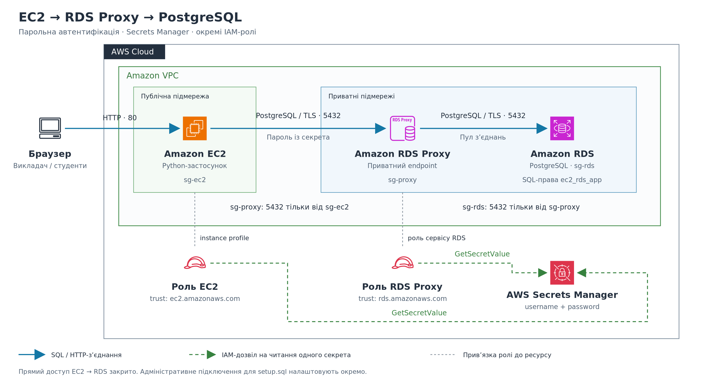

# EC2 → RDS Proxy → RDS PostgreSQL

[SVG для редагування](architecture.svg). Використано офіційні
[AWS Architecture Icons](https://aws.amazon.com/architecture/icons/),
набір від 31.07.2026. Діаграма спрощує фізичне розміщення ресурсу між AZ.

Застосунок і проксі читають той самий секрет, використовуючи різні IAM-ролі.
EC2 підключається до приватного endpoint RDS Proxy з паролем із Secrets Manager.
Проксі використовує пул з'єднань до RDS PostgreSQL і credentials цього секрета.
Роль EC2 не відкриває мережеві порти та не передається проксі.

## Підготовка бази

Виконати кроки 1–4 [README](README.md) для створення RDS, demo.messages,
користувача ec2_rds_app, секрета та ролі EC2. Перевірити підтримку версії
PostgreSQL і регіону у
[документації RDS Proxy](https://docs.aws.amazon.com/AmazonRDS/latest/UserGuide/rds-proxy.html).

Для нового прикладу setup.sql уже задає statement_timeout = 5s та
default_transaction_read_only = on на рівні користувача. Якщо база створена
попередньою версією прикладу, виконати від адміністратора до створення проксі.

~~~sql
ALTER ROLE ec2_rds_app SET statement_timeout = '5s';
ALTER ROLE ec2_rds_app SET default_transaction_read_only = on;
~~~

Ці defaults застосовуються до нових backend-з'єднань. Наявні з'єднання пулу
не обов'язково змінять свої параметри відразу.

IAM database authentication на RDS для цього маршруту не вмикати;
користувачу ec2_rds_app не видавати rds_iam. Зберегти службову базу postgres,
яка потрібна RDS Proxy.

## Окрема роль проксі

Створити окрему IAM-роль із proxy-iam-trust-policy.json.
Її trusted service — rds.amazonaws.com, у ролі EC2 — ec2.amazonaws.com.

Заповнити proxy-iam-policy.json.

| Підстановка | Значення |
|---|---|
| REPLACE_WITH_FULL_SECRET_ARN | Повний ARN того самого секрета ec2_rds_app |
| REPLACE_WITH_SECRET_KMS_KEY_ARN | ARN KMS-ключа, яким зашифровано цей секрет |
| REPLACE_WITH_REGION | Регіон секрета, наприклад eu-central-1 |

Ключ можна знайти у властивостях секрета. ARN потрібний і для ключа
aws/secretsmanager. Для власного KMS-ключа key policy також має дозволяти
використання ключа роллю проксі. Дозвіл kms:Decrypt у шаблоні обмежено
викликами через регіональний Secrets Manager.
[Роль проксі та доступ до секретів](https://docs.aws.amazon.com/AmazonRDS/latest/UserGuide/rds-proxy-iam-setup.html).

Роль проксі призначається RDS Proxy, а не EC2. Роль EC2 залишається з доступом
GetSecretValue до цього секрету. Дозвіл rds-db:connect для парольного маршруту
не потрібний. Його використовують у варіанті IAM-аутентифікації клієнта,
який у цьому прикладі не реалізовано.

## Обмеження IAM у навчальному акаунті

Помилка створення проксі з повідомленням not authorized to perform:
iam:CreateRole означає, що консоль спробувала створити IAM-роль, а поточна
сесія не має цього дозволу. Вона не свідчить про неправильний пароль БД
або мережеві правила.

У полі IAM role можна вибрати вже підготовлену роль. Якщо консоль показує
автоматичне керування роллю, відкрити Customize та вибрати наявну роль.
[Вибір ролі під час створення проксі](https://docs.aws.amazon.com/AmazonRDS/latest/UserGuide/rds-proxy-creating.html).

Для парольного маршруту перевірити всі умови.

- Trust policy дозволяє сервісу rds.amazonaws.com виконувати sts:AssumeRole.
- Permissions policy дозволяє читати потрібний секрет через
  secretsmanager:GetSecretValue та використовувати його KMS-ключ.
- Сесія, яка створює проксі, має iam:PassRole для цієї ролі й необхідні
  RDS-дозволи. Вибір наявної ролі усуває потребу в CreateRole, але не в PassRole.

[Trust policy та права ролі проксі](https://docs.aws.amazon.com/AmazonRDS/latest/UserGuide/rds-proxy-iam-setup.html),
[передавання ролі сервісу](https://docs.aws.amazon.com/IAM/latest/UserGuide/id_roles_use_passrole.html).

Назва LabRole сама по собі не підтверджує ці умови. Роль, що працює для EC2,
не обов'язково має trust policy для RDS Proxy. Не призначати її проксі
без перевірки. Наявність ролі у списку також не доводить доступ до секрета.

Якщо придатної ролі немає, а її створення або зміна заборонені, адміністратор
навчального середовища має підготувати роль і дозволити її передавання RDS.
Зміна параметрів застосунку або запуск тієї самої операції через CLI
не надають відсутніх IAM-дозволів.

До підготовки ролі можна виконувати базовий маршрут EC2 → RDS без проксі,
якщо наявна роль EC2 має доступ до секрета. Для нового інстанса в user-data.sh
задати DB_TARGET=direct і DB_HOST=endpoint RDS. Bootstrap завантажить RDS CA
bundle; sg-rds має дозволяти TCP 5432 від sg-ec2.
Для вже запущеного proxy-режиму зміни двох env-полів недостатньо —
також замінити CA bundle на RDS CA за [README](README.md).
Цей маршрут демонструє роль EC2, Secrets Manager, TLS і SQL-права;
пул RDS Proxy у ньому не використовується.

### Перевірка наявної ролі з навчального термінала

Виконати команди в терміналі з чинною сесією навчального акаунта та AWS CLI.
Сесія користувача, яка створює проксі, і роль застосунку на EC2 мають різні
права. Спочатку перевірити, від чийого імені працює термінал.

~~~bash
aws sts get-caller-identity --output json --no-cli-pager
~~~

Якщо серед наявних ролей є LabRole, прочитати її ARN і trust policy.
Для іншої ролі замінити LabRole її назвою.

~~~bash
aws iam get-role --role-name LabRole \
  --query 'Role.{Arn:Arn,Trust:AssumeRolePolicyDocument}' \
  --output json --no-cli-pager
~~~

У trust policy шукати Allow для sts:AssumeRole із principal
rds.amazonaws.com. Service може бути рядком або масивом.
Умови Condition також можуть обмежувати прийняття ролі.
Якщо дозволено лише ec2.amazonaws.com, ця роль не придатна для RDS Proxy
без зміни trust policy адміністратором.
[Читання ролі через AWS CLI](https://docs.aws.amazon.com/cli/latest/reference/iam/get-role.html).

Перелік прикріплених та inline policies можна отримати окремо.

~~~bash
aws iam list-attached-role-policies --role-name LabRole \
  --output json --no-cli-pager
aws iam list-role-policies --role-name LabRole \
  --output json --no-cli-pager
~~~

Ці команди повертають назви та ARN policies, а не доводять фактичні права.
Їхній вміст перевіряють у IAM → Roles → Permissions.
[Прикріплені policies](https://docs.aws.amazon.com/cli/latest/reference/iam/list-attached-role-policies.html),
[inline policies](https://docs.aws.amazon.com/cli/latest/reference/iam/list-role-policies.html).

AccessDenied під час get-role означає, що сесія не може прочитати роль;
це не доводить відсутність ролі або неправильну trust policy.
У такому разі налаштування має перевірити адміністратор.
Наявність IAM-дозволів у policy також не скасовує explicit deny або інші
обмеження акаунта.

Якщо роль придатна, повторити створення проксі з її ARN або вибором у консолі.
При наступній відмові перевіряти саме дію з нового повідомлення.
Для iam:PassRole потрібен дозвіл у сесії створення проксі, а не додаткова
policy у ролі EC2 чи ролі проксі.

### Пряме підключення на вже запущеному EC2

Цей варіант зберігає роль EC2 та отримання пароля із Secrets Manager.
Він доступний лише за наявності придатного instance profile і права EC2
читати секрет. Відмова CreateRole під час створення проксі сама по собі
не підтверджує ці права.

У sg-rds додати вхідний TCP 5432 із sg-ec2 та перевірити вихідний доступ
EC2 до RDS. Використати приватний endpoint RDS у тій самій VPC.
Обліковий запис і таблиця залишаються підготовленими за README.

На EC2 завантажити RDS CA bundle в окремий файл. Bundle для проксі
залишається доступним для повернення до proxy-режиму.

~~~bash
task_rds_ca=$(mktemp)
curl --fail --silent --show-error --retry 3 \
  https://truststore.pki.rds.amazonaws.com/global/global-bundle.pem \
  -o "$task_rds_ca" && \
sudo install -m 644 "$task_rds_ca" /opt/ec2-rds-secrets/rds-ca-bundle.pem && \
rm -- "$task_rds_ca"
~~~

Якщо curl завершився помилкою, не виконувати наступні команди цього блока.
Завантаження потребує вихідного HTTPS-доступу.
[CA для RDS PostgreSQL](https://docs.aws.amazon.com/AmazonRDS/latest/UserGuide/PostgreSQL.Concepts.General.SSL.html).

Відкрити конфігурацію служби.

~~~bash
sudoedit /etc/ec2-rds-secrets.env
~~~

Замінити три поля. Замість REPLACE_WITH_RDS_ENDPOINT вказати власний endpoint
RDS. AWS_REGION, DB_SECRET_ARN, DB_NAME і DB_PORT залишити відповідними
підготовленій базі; для стандартного PostgreSQL порт дорівнює 5432.

~~~text
DB_TARGET=direct
DB_HOST=REPLACE_WITH_RDS_ENDPOINT
DB_SSLROOTCERT=/opt/ec2-rds-secrets/rds-ca-bundle.pem
~~~

Перезапустити службу та перевірити її стан.

~~~bash
sudo systemctl restart ec2-rds-secrets
sudo systemctl status ec2-rds-secrets --no-pager
~~~

На сторінці натиснути «Перечитати секрет». Очікуються режим direct,
етап «TCP до RDS», клієнтський TLS verify-full і рядки demo.messages.
Перевірка /healthz не підтверджує доступ до БД.

Для досліду мережевої відмови в direct-режимі змінювати правило від sg-ec2
у sg-rds. IAM- і SQL-досліди залишаються такими самими.
Перевірки пулу та CloudWatch-метрик RDS Proxy тут не виконуються.

Після підготовки проксі повернути DB_TARGET=proxy, його DB_HOST
і DB_SSLROOTCERT=/opt/ec2-rds-secrets/db-ca-bundle.pem, якщо цей файл
містить системний CA bundle з початкового proxy-bootstrap.
Відновити маршрут через sg-proxy, перезапустити службу й підтвердити SELECT.
Пряме правило sg-ec2 → sg-rds прибрати після підтвердження маршруту через проксі.

## Security groups

| Група | Вхідний трафік | Вихідний трафік |
|---|---|---|
| sg-ec2 | TCP 80 із навчальної мережі | TCP 5432 до sg-proxy; HTTPS до потрібних API й джерел коду |
| sg-proxy | TCP 5432 від sg-ec2 | TCP 5432 до sg-rds |
| sg-rds | TCP 5432 від sg-proxy | Відповіді на встановлені з'єднання |

Правило прямого доступу sg-ec2 → sg-rds після переходу на проксі прибрати.
Для setup.sql та адміністративних команд використовувати окрему
адміністративну security group або тимчасове правило, яке потім видаляють.

RDS Proxy має бути у VPC бази; він не є публічним endpoint.
Вибрати щонайменше дві приватні підмережі й перевірити маршрути,
NACL та доступні для регіону AZ.
[Створення RDS Proxy](https://docs.aws.amazon.com/AmazonRDS/latest/UserGuide/rds-proxy-creating.html).

## Створення проксі

У RDS → Proxies → Create proxy задати такі параметри.

| Параметр | Значення |
|---|---|
| Engine family | PostgreSQL |
| Database | Підготовлений RDS instance |
| IAM role | Окрема роль проксі |
| Default authentication scheme | None |
| Secrets Manager secrets | Секрет ec2_rds_app |
| Client authentication type | SCRAM-SHA-256 для бази з SCRAM-паролем |
| IAM authentication | Not allowed |
| Require Transport Layer Security | Увімкнено |
| Subnets | Приватні підмережі цієї VPC |
| VPC security group | sg-proxy |

Нові RDS PostgreSQL зазвичай використовують SCRAM. Перед вибором типу
перевірити конфігурацію підготовленої БД; для MD5-користувача тип має відповідати
фактичному способу збереження пароля. У цьому демо автоматичний вибір не виконується.

Дочекатися статусу Available у проксі та AVAILABLE у target.
Скопіювати endpoint проксі. Це інша адреса, ніж endpoint RDS.
TCP до проксі може працювати навіть за недоступного target;
тоді відмовить етап входу або SQL-запиту.
[Підключення через проксі](https://docs.aws.amazon.com/AmazonRDS/latest/UserGuide/rds-proxy-connecting.html).

## Налаштування застосунку

Для нового EC2 user-data.sh уже використовує DB_TARGET=proxy.
Заповнити DB_HOST endpoint проксі та DB_SECRET_ARN ARN секрета.
Bootstrap установлює ca-certificates і копіює системний trust store в
/opt/ec2-rds-secrets/db-ca-bundle.pem.

RDS Proxy використовує сертифікати ACM. RDS global-bundle.pem призначений
для прямого RDS endpoint і не підходить як єдине джерело довіри до проксі.
Клієнт зберігає sslmode=verify-full, використовує endpoint AWS без власного
DNS alias і перевіряє клієнтський TLS через libpq.
[Сертифікати й TLS проксі](https://docs.aws.amazon.com/AmazonRDS/latest/UserGuide/rds-proxy.howitworks.html).

Для вже запущеного EC2 завантажити оновлений код через bootstrap або інший
наявний механізм розгортання. Після цього конфігурація служби має містити
наступні значення, де підстановки замінюють власними адресами та ARN.

~~~text
DB_TARGET=proxy
DB_HOST=REPLACE_WITH_PROXY_ENDPOINT
DB_PORT=5432
DB_NAME=infrastructure
DB_SECRET_ARN=REPLACE_WITH_FULL_SECRET_ARN
DB_SSLROOTCERT=/opt/ec2-rds-secrets/db-ca-bundle.pem
~~~

Після зміни /etc/ec2-rds-secrets.env перезапустити службу.

~~~bash
sudo systemctl restart ec2-rds-secrets
~~~

Прямий режим для порівняння використовує DB_TARGET=direct, endpoint RDS
і RDS CA bundle. Якщо запускати user-data.sh із DB_TARGET=direct, він
завантажить відповідний bundle сам. Для прямого маршруту потрібне окреме
правило sg-ec2 → sg-rds; воно не є частиною основної схеми з проксі.

## Спостереження на занятті

1. Перевірити всі п'ять етапів через endpoint проксі.
2. Прибрати прямий доступ EC2 до RDS. Маршрут через проксі має працювати.
3. Прибрати вхідне правило sg-proxy від sg-ec2. Новий TCP-запит має відмовити.
4. Повернути правило. Перевірити SQL-права через REVOKE/GRANT SELECT.
5. У CloudWatch порівняти ClientConnections, DatabaseConnections і
   DatabaseConnectionsCurrentlySessionPinned під час серії запитів.

Один запит діагностичного застосунку відкриває коротке клієнтське з'єднання.
Цього достатньо для перевірки маршруту, але недостатньо для висновку про
продуктивність пулу. Для порівняння метрик потрібні повторювані запити та
однакове навантаження. Пул не гарантує менший час кожного SQL-запиту.

Застосунок не передає startup options, не виконує SET у клієнтській сесії
і вимикає автоматичні named prepared statements. Defaults задаються у БД.
Для PostgreSQL SET та деякі інші операції можуть прив'язати клієнт до одного
backend-з'єднання — session pinning — і зменшити можливість повторного використання
пулу іншими клієнтами.
[Умови pinning](https://docs.aws.amazon.com/AmazonRDS/latest/UserGuide/rds-proxy-pinning.html).

Зміну пароля узгоджують між PostgreSQL і Secrets Manager. Проксі також кешує
credentials і тримає backend-з'єднання, тому оновлення не слід трактувати
як миттєве для всіх сесій. Кнопка перечитування оновлює кеш застосунку;
вона не керує кешем самого RDS Proxy.

## Перевірка та завершення

Локально перевіряються код, TLS, SQL і bootstrap; справжній RDS Proxy не
замінюється PostgreSQL-контейнером у твердженнях про готовність AWS-маршруту.
Статуси target, IAM/KMS-доступ проксі й мережеві правила потрібно перевірити
в навчальному AWS-акаунті.

Після заняття видалити RDS Proxy та створені для нього роль і policies,
а також ресурси базового прикладу, які більше не потрібні.
RDS Proxy оплачується окремо від RDS.

Джерела й іконки перевірено 05.10.2026. Розділ про обмеження IAM
у навчальному акаунті додано й звірено з документацією 11.10.2026.
